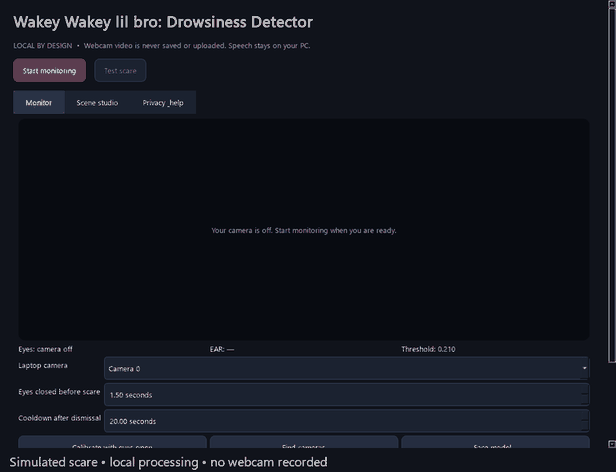

# Wakey Wakey lil bro: Drowsiness Detector

A Windows desktop app that detects sustained eye closure and wakes you with a customizable monster scene. Python, OpenCV, MediaPipe, PySide6, and local Piper speech.



Six-second preview with simulated input. [MP4 version](demo/readme-preview.mp4) · [Desktop UI](docs/screenshots/desktop.png)

## Run

Python 3.13, Windows, and a webcam are required for monitoring. Test scare works without a camera.

```powershell
py -3.13 -m venv .venv
.\.venv\Scripts\python -m pip install -r requirements.txt
.\.venv\Scripts\python tools/setup_models.py
.\.venv\Scripts\python tools/prepare_assets.py
$env:PYTHONPATH = "$PWD\src"
.\.venv\Scripts\python -m drowsy_guard
```

Cameras scan automatically on startup. Choose your laptop camera, start monitoring, and calibrate with eyes fully open. Short blinks are ignored. Sustained closure triggers one scare; eyes must reopen and the cooldown must finish before another. Move the mouse or press any key to dismiss; every scene ends within 15 seconds. Music begins after half a second; speech after two seconds. Exactly one background track plays: your selected music/jumpscare file, or the generated horror bed when no usable file is selected.

**Scene studio** shows every phrase. Add/edit/delete, enable/disable, preview a draft before saving, or attach your own recording. **All phrases unchecked means music and visuals only**; no hidden phrases are substituted. A single enabled phrase alternates with a silent scene to avoid consecutive repeats.

The [phrase catalog](docs/phrases.md) includes 22 defaults, with `{app}`, `{name}`, `{time}`, and `{seconds}` (`{closed_seconds}` is an alias). Use **Select all / Unselect all** to manage the list. Name personalization is off by default: enable **Use {name} in phrases**, enter a name or click **Use Windows name**, and edit the suggestion if needed. Account names may differ from real names. Unknown values are skipped. Contextual speech is prepared asynchronously before the scene opens.

In Monitor, enable the **global scare shortcut**, record one combination (for example Ctrl+Alt+J), and save it. It triggers a random scene while this app is running, even when another app has focus. Windows shortcut conflicts are shown; held keys do not repeatedly trigger scenes. Camera monitoring is not required.

Default user folders are `%APPDATA%/WakeyMonster/assets/monsters`, `backgrounds`, and `music`. The storage name is retained so existing settings survive upgrades. First launch creates these writable folders and supplies an original monster and **Midnight Signal**, an original synthesized BGM dedicated under CC0. Backgrounds are optional; white is the default. **Open default asset folders** opens their location, and **Use default assets** restores these choices. Valid existing custom paths are preserved. Copyrighted FNAF audio and personal media are never bundled.

## Privacy

Everything runs on the PC. **No webcam video is saved or uploaded.** Temporary desktop-glitch pixels are discarded in memory. Foreground titles have no activity log, although locally cached speech can contain a title or the optional name. Name autofill is only read when requested. Global shortcuts use Windows registration, without keyboard logging. Configuration and WAVs stay in your Windows app-data folder. Model setup downloads files; normal operation needs no internet.

## Desktop build and demo

```powershell
.\.venv\Scripts\python -m pip install -r requirements-build.txt
.\.venv\Scripts\python tools/build_app.py
```

Launch `dist/WakeyWakeyLilBro/WakeyWakeyLilBro.exe`; keep the whole folder together. Models are bundled, so Python is not required on the destination Windows PC. [60-second demo](demo/demo-60s.mp4) uses simulated eye readings and real UI/overlay rendering; it records no personal webcam or desktop. Recreate it with `tools/make_demo.py`; regenerate the short preview with `tools/make_readme_preview.py`.

The build collects inference libraries without optional training/server tools or personal media. This is a tested prototype progressing toward release; see [release readiness](docs/release-readiness.md) before publishing a binary.

The generated voice uses lowered pitch, growl, breath, and stereo echoes. For a more convincing performance, attach a whispered or acted recording to a phrase in Scene studio. Recordings replace generated speech; they do not add another BGM.

## Checks

```powershell
$env:PYTHONPATH = "$PWD\src"
.\.venv\Scripts\python -m unittest discover -s tests -v
$env:QT_QPA_PLATFORM = 'offscreen'
.\.venv\Scripts\python tests/scene_smoke.py
.\.venv\Scripts\python tests/desktop_smoke.py
Remove-Item Env:QT_QPA_PLATFORM
```

See [manual checks and file guide](docs/development.md), [demo pitch](demo/pitch.md), and [asset/dependency notices](THIRD_PARTY.md). Physical camera, sound, and multi-monitor behavior require manual checks. This is a hackathon prototype; it has not been medically validated.
